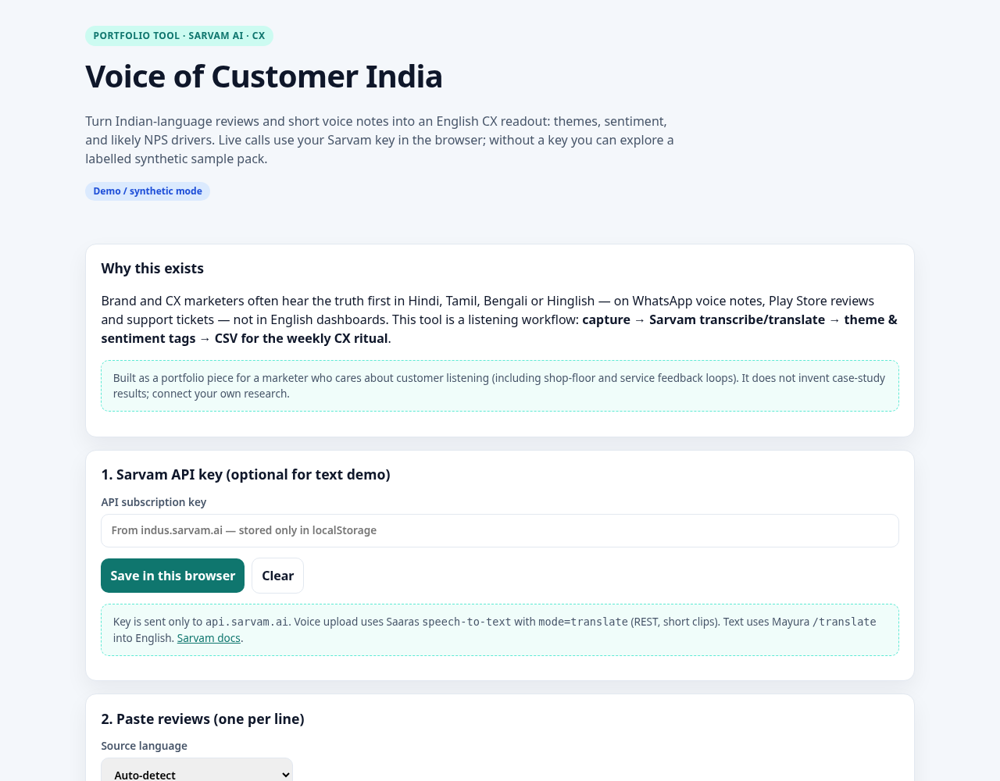

# Voice of Customer India

**[Try it live](https://yashsarkar1806-creator.github.io/voice-of-customer-india/)** · listen to Indian-language customer feedback with [Sarvam AI](https://docs.sarvam.ai).



## What it is

A static CX tool that:

1. Accepts pasted reviews in Indian languages (or English).
2. Optionally uploads a short voice note.
3. Uses Sarvam **Mayura translate** and **Saaras speech-to-text** (`mode=translate`) when you paste your own API key.
4. Tags **themes**, **sentiment**, and **likely NPS drivers** on the English text.
5. Exports a **CSV** for weekly CX rituals.

Without a key, a labelled **synthetic** sample pack still demonstrates the readout.

## Why it matters for a marketer

Customer truth often shows up first in vernacular voice notes and reviews. A product marketer who listens in the customer’s language — then translates for the wider team — closes the gap between store/service reality and the English dashboard. This repo is a portable listening workflow, not a claim about any one brand’s results.

## Demo vs live

| Input | No key | With Sarvam key |
|-------|--------|-----------------|
| Synthetic samples | Theme/sentiment on bundled English translations | Same |
| Pasted Indic text | Local tagging only (no translation) | Live `/translate` → EN, then tag |
| Voice note | Blocked with a clear message | Live `/speech-to-text` translate mode |

Key stays in browser `localStorage` only.

## Run locally

```bash
python3 -m http.server 8080
npm test
```

## Wispr Flow

[Wispr Flow](https://wisprflow.ai/) helps marketers draft by voice. Its API is not publicly available without enterprise approval, so customer-audio transcription here uses Sarvam Saaras.

## License

MIT · Built by [Yash Sarkar](https://github.com/yashsarkar1806-creator). Sample data is synthetic. Not affiliated with Sarvam AI or Wispr Flow.
